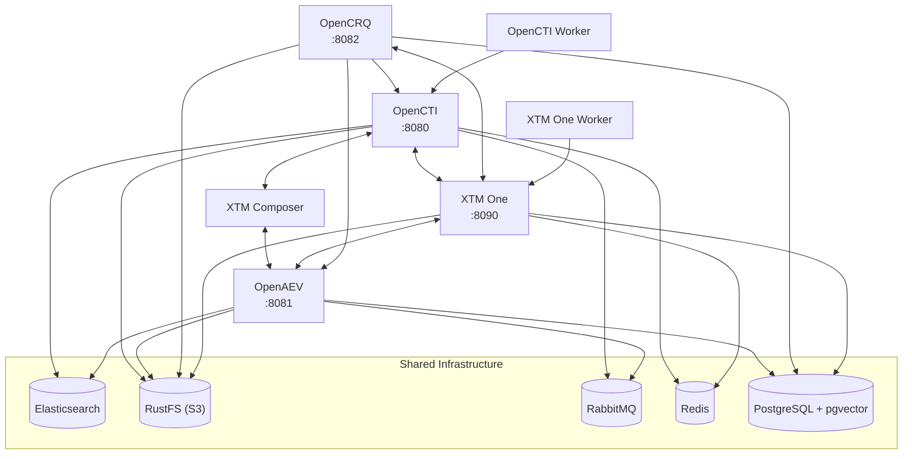

# XTM Docker Deployment

Docker deployment for the **eXtended Threat Management (XTM)** stack, combining [OpenCTI](https://github.com/OpenCTI-Platform/opencti), [OpenAEV](https://github.com/OpenAEV-Platform/openaev), OpenCRQ and [XTM One](https://github.com/XTM-One-Platform/xtm-one) into a unified threat intelligence, adversary emulation and AI-assisted analysis platform.

## Overview

This repository provides a complete Docker Compose setup for running:

- **OpenCTI** — Open Cyber Threat Intelligence Platform
- **OpenAEV** — Open Adversary Emulation & Validation Platform
- **OpenCRQ** — Cyber Risk Quantification platform (its image is private until its release)
- **XTM One** — AI-powered assistant connecting OpenCTI and OpenAEV
- **XTM Composer** — Unified connector/collector management
- **Shared Infrastructure** — Elasticsearch, RustFS (S3 object storage), RabbitMQ, Redis, PostgreSQL + pgvector (one database each for OpenAEV, OpenCRQ and XTM One)

## Prerequisites

- Docker Engine 20.10+ with Docker Compose v2.20.2+, or Podman with podman-compose 1.6.0+
- Minimum 16GB RAM (recommended 32GB for production)
- At least 50GB available disk space
- On a Mac with an Apple chip (or any ARM machine): Docker Desktop with **Use Rosetta for x86_64/amd64 emulation** on. XTM One is published for amd64 only and runs through emulation; the compose file pins its platform, so nothing else is needed.

## Architecture



`docker-compose.yml` includes one file per part of the stack:

| File | Services |
|------|----------|
| `infra/redis.yml` | Redis |
| `infra/elasticsearch.yml` | Elasticsearch |
| `infra/postgresql.yml` | PostgreSQL + pgvector |
| `infra/rustfs.yml` | RustFS (S3) |
| `infra/rabbitmq.yml` | RabbitMQ, with `infra/rabbitmq.conf` |
| `modules/xtm-one.yml` | XTM One, its worker and the initialisation of its database |
| `modules/opencti.yml` | OpenCTI, its worker and the default OpenCTI connectors |
| `modules/openaev.yml` | OpenAEV and the default OpenAEV collectors and injectors |
| `modules/opencrq.yml` | OpenCRQ and the initialisation of its database and bucket |
| `modules/xtm-composer.yml` | XTM Composer and the generation of its RSA key |

## Quick Start

### 1. Clone the repository

```bash
git clone https://github.com/FiligranHQ/xtm-docker.git
cd xtm-docker
```

### 2. Create the configuration

```bash
docker compose -f init.yml run --rm init
```

This creates `.env` from [.env.sample](.env.sample), with a random value for every password, key and token, the users of PostgreSQL and RabbitMQ, and mail sent to `localhost` until you set your SMTP server. It runs in a temporary Alpine container, so it needs nothing but Docker, on Linux, macOS and Windows. It prints the URLs and the admin passwords; every secret stays in `.env`, which only you can read. It never overwrites an existing `.env`.

> **Your own values:** edit `.env` afterwards, before the first start, for your host names (`*_HOST`, `*_EXTERNAL_SCHEME`, `*_PORT`), your SMTP server or the admin emails. `OPENCTI_ENCRYPTION_KEY` is a 32-byte base64 key, not a UUID. `PLATFORM_REGISTRATION_TOKEN` is the shared secret that lets OpenCTI, OpenAEV and OpenCRQ register with XTM One: every platform of the stack uses the same value. The full XTM One configuration (admin credentials, the credentials of its PostgreSQL role, S3 bucket, license) lives at the bottom of `.env`.

### 3. Start the stack

```bash
docker compose up -d --pull always
```

`--pull always` downloads the images first, even if you have run the stack before: Docker Compose would otherwise start an older image kept locally under the same `latest` tag. `docker compose up -d` starts the whole XTM stack: XTM One, OpenCTI, OpenAEV, OpenCRQ, XTM Composer, the default connectors, collectors and injectors, and the shared services. Every module is part of the platform: none is optional.

### 4. Access the platforms

Once all services are healthy (this may take a few minutes on first start):

- **OpenCTI**: http://localhost:8080
- **OpenAEV**: http://localhost:8081
- **OpenCRQ**: http://localhost:8082
- **XTM One**: http://localhost:8090
- **RabbitMQ Management**: http://localhost:15672

Sign in to XTM One, OpenCTI and OpenAEV with the admin email and password of each in `.env`. OpenCRQ has no password: **Sign in with XTM One**, as XTM One's admin, makes you its super administrator. It starts with no tenant: create the first one, put its id (the UUID in its URL, `/<id>/...`) in `OPENCRQ_TENANT_ID` in `.env`, then run `docker compose up -d` again, so that the OpenCTI and OpenAEV connectors of OpenCRQ feed that tenant.

> **Public and internal URLs:** the URLs above (built from `OPENCTI_HOST`, `OPENAEV_HOST`, `XTM_ONE_HOST`, their ports and their `*_EXTERNAL_SCHEME`: set the scheme to `https` together with the host when you publish them over TLS) are also the identity each product signs its requests to the others with, so they are set on both XTM One containers (`BASE_URL`). Inside the stack the containers reach each other on their service names (`http://opencti:8080`, `http://openaev:8080`, `http://xtm-one:4000`), so the public host names do not need to resolve inside Docker. This needs XTM One, OpenCTI and OpenAEV releases that include [XTM-One-Platform/xtm-one#4883](https://github.com/XTM-One-Platform/xtm-one/pull/4883), [OpenCTI-Platform/opencti#18585](https://github.com/OpenCTI-Platform/opencti/pull/18585) and [OpenAEV-Platform/openaev#8143](https://github.com/OpenAEV-Platform/openaev/pull/8143).

## Included Components

### OpenCTI Connectors

| Connector | Description |
|-----------|-------------|
| Export File STIX | Export data in STIX 2.1 format |
| Export File CSV | Export data in CSV format |
| Export File TXT | Export data in plain text format |
| Import File STIX | Import STIX 2.1 bundles |
| Import Document | Import and analyze PDF, HTML, and text documents |
| Import File YARA | Import YARA rules |
| Analysis | Document analysis connector |
| Import External Reference | Import external references |
| OpenCTI Datasets | Default marking definitions and identities |
| MITRE ATT&CK | MITRE ATT&CK framework data |

### OpenAEV Collectors

| Collector | Description |
|-----------|-------------|
| MITRE ATT&CK | Attack techniques and procedures |
| OpenAEV Datasets | Default datasets and configurations |
| Atomic Red Team | Red Canary's Atomic Red Team tests |
| NVD NIST CVE | CVE data from NVD (requires API key) |

### OpenAEV Injectors

| Injector | Description |
|-----------|-------------|
| Nmap | Network scanning capabilities |
| Nuclei | Vulnerability scanning with Nuclei |

## Configuration

### Existing deployments

Updating a stack that ran MinIO or Silo: read [Upgrade a stack that ran MinIO or Silo](#upgrade-a-stack-that-ran-minio-or-silo) first: its first steps run before the `git pull`.

A `.env` made for an earlier version of this repository may still have a `COMPOSE_PROFILES` line, and `XTM_COMPOSER_OPENCTI_ENABLE` or `XTM_COMPOSER_OPENAEV_ENABLE`. They no longer do anything: the whole stack always starts, and XTM Composer always manages both platforms. Remove them from your `.env`.

### OpenCRQ

OpenCRQ starts with the rest of the stack, together with two one-shot services that prepare its storage on each start: `opencrq-db-init` creates its database in the shared `pgsql` instance, where OpenCRQ connects as `POSTGRES_USER` like OpenAEV, and `opencrq-bucket-init` creates its bucket in RustFS.

OpenCRQ registers with XTM One with the same `PLATFORM_REGISTRATION_TOKEN`, and its OpenCTI and OpenAEV connectors are preconfigured with the admin tokens of both platforms. After the first start:

1. Create the first OpenCRQ admin in the setup wizard at http://localhost:8082. Use the `XTM_ONE_ADMIN_EMAIL` address: XTM One matches users by email.
2. In **Integrations**, link a service account to the OpenCTI and OpenAEV connectors. For OpenCTI, also pick a live stream whose filter lets through the threats and their relationships (`targets`, `uses`, `attributed-to`): a stream filtered on threats alone delivers bare threats.

Limitations:

- The OpenCRQ session cookie is `Secure`. Over plain HTTP, browsers accept it on `localhost` at most, so a remote OpenCRQ must be published over TLS (`OPENCRQ_EXTERNAL_SCHEME=https`).
- The links OpenCRQ shows to OpenCTI and OpenAEV objects use the connector URLs, which are the internal `http://opencti:8080` and `http://openaev:8080`.
- OpenCRQ takes its edition from the XTM license XTM One returns. Without one it runs Community Edition: a single tenant and no embedded Ask Ariane chat.
- OpenCRQ adds an HTTP and a worker process (heap capped at 512 MB and 4 GB) and about 50 PostgreSQL connections at peak to the `pgsql` instance it shares with OpenAEV and XTM One.

### Memory Requirements

Adjust `ELASTIC_MEMORY_SIZE` based on your available RAM:

| Total RAM | Recommended Setting |
|-----------|---------------------|
| 16GB | `2G` |
| 32GB | `4G` |
| 64GB+ | `8G` |

### Scaling Workers

Modify the worker replicas in `modules/opencti.yml`:

```yaml
worker:
  deploy:
    mode: replicated
    replicas: 3  # Increase for higher throughput
```

### External Access

To expose the platforms externally (behind reverse-proxy for instance), update the environment variables:

```bash
OPENCTI_EXTERNAL_SCHEME=https
OPENCTI_HOST=opencti.yourdomain.com
OPENCTI_PORT=443

OPENAEV_EXTERNAL_SCHEME=https
OPENAEV_HOST=openaev.yourdomain.com
OPENAEV_PORT=443

OPENCRQ_EXTERNAL_SCHEME=https
OPENCRQ_HOST=opencrq.yourdomain.com
OPENCRQ_PORT=443
```

## Common Operations

### View logs

```bash
# All services
docker compose logs -f

# Specific service
docker compose logs -f opencti
docker compose logs -f openaev
```

### Check service health

```bash
docker compose ps
```

### Stop the stack

```bash
docker compose down
```

### Reset data (destructive)

```bash
docker compose down -v
```

### Upgrade a stack that ran MinIO or Silo

The `minio` service runs [RustFS](https://rustfs.com), an open source (Apache 2.0) S3-compatible object storage. The service name, the `s3data` volume and the `MINIO_ROOT_USER` / `MINIO_ROOT_PASSWORD` variables keep their former names, so the OpenCTI, OpenAEV, OpenCRQ and XTM One settings do not change.

RustFS does not start on an `s3data` volume written by MinIO or Silo (`Permission denied`: that volume belongs to root, RustFS runs as uid 10001). The volume (`xtm_s3data` with the project name of `.env.sample`) holds the buckets of OpenCTI, OpenAEV, OpenCRQ and XTM One. Back it up and move it with the migration guide listed in the [breaking changes of the OpenCTI documentation](https://docs.opencti.io/latest/deployment/breaking-changes/) (the [OpenAEV breaking changes](https://docs.openaev.io/latest/deployment/breaking-changes/) list the same move) before the next `docker compose up -d` with this compose file, then check a file in each platform. The guide's first steps run with the previous compose file: if you update this clone with `git pull`, run them before the pull.

If your stack ran a `pgsql-xtm-one` container (separate PostgreSQL instances), follow [Upgrade from separate PostgreSQL instances](#upgrade-from-separate-postgresql-instances) too: dump the databases and back up the storage volume before the pull, and start the stack only once the databases are restored and the storage is moved.

Started without moving the storage: `docker compose up -d` stops on the unhealthy `minio` service (`docker compose logs minio` shows `Permission denied`), and the data of the volume is unchanged. The guide explains how to go back to the previous storage service. If your stack ran a `pgsql-xtm-one` container, read the last paragraph of [Upgrade from separate PostgreSQL instances](#upgrade-from-separate-postgresql-instances) before running `docker compose up -d` again.

### Upgrade from separate PostgreSQL instances

Earlier versions of this stack ran two PostgreSQL containers: `pgsql` for OpenAEV and `pgsql-xtm-one` for XTM One. These versions also ran MinIO or Silo: read [Upgrade a stack that ran MinIO or Silo](#upgrade-a-stack-that-ran-minio-or-silo) first: the storage has to be moved too before the final `docker compose up -d`. OpenAEV and XTM One now share one pgvector instance, on a new `pgsqlshareddata` volume, and the old volumes are left untouched. To keep your data, dump both databases **before** you pull the new version:

```bash
docker compose stop openaev xtm-one xtm-one-worker
docker compose exec -T pgsql sh -c 'pg_dump -U "$POSTGRES_USER" -Fc openaev' > openaev.dump
docker compose exec -T pgsql-xtm-one sh -c 'pg_dump -U "$POSTGRES_USER" -Fc xtm_one' > xtm_one.dump
docker compose down
```

Then pull the new version, prepare the shared instance (the `xtm-one-db-init` service creates the XTM One role, its database and the pgvector extension), restore both databases and start the stack:

```bash
git pull
docker compose run --rm xtm-one-db-init
docker compose exec -T pgsql sh -c 'pg_restore -U "$POSTGRES_USER" -d openaev' < openaev.dump
docker compose exec -T pgsql sh -c 'pg_restore -U "$POSTGRES_USER" -d xtm_one' < xtm_one.dump
docker compose up -d
```

Once both platforms show their data, remove the old volumes (their prefix is your `COMPOSE_PROJECT_NAME`):

```bash
docker volume rm xtm_pgsqldata xtm_pgsqlxtmonedata
```

If you started the new version before dumping, your data is still in the old volumes. The `xtm_pgsqlshareddata` volume then holds the databases the platforms created on that start, with everything written to them since, and removing it deletes those writes for good: if you need any of them, dump both databases from `pgsql` first, with the same `pg_dump` commands. Then run `docker compose down`, remove the `xtm_pgsqlshareddata` volume, check out the previous version of this repository, and follow the steps above.

## Troubleshooting

### Services not starting

1. Check if Elasticsearch has enough virtual memory:
   ```bash
   sudo sysctl -w vm.max_map_count=262144
   ```

2. Verify all environment variables are set in `.env`

3. Check logs for specific errors:
   ```bash
   docker compose logs <service-name>
   ```

### OpenCTI/OpenAEV not connecting

1. Ensure all dependency services are healthy
2. Verify tokens match between services
3. Check network connectivity within Docker network

## Community

### Status & Bugs

If you wish to report bugs or request new features:

- **OpenCTI**: [GitHub Issues](https://github.com/OpenCTI-Platform/opencti/issues)
- **OpenAEV**: [GitHub Issues](https://github.com/OpenAEV-Platform/openaev/issues)

### Discussion

For support or discussions about the XTM stack, join us on our [Slack channel](https://community.filigran.io) or email us at contact@filigran.io.

## About

XTM is a product suite designed and developed by [Filigran](https://filigran.io).

<a href="https://filigran.io" alt="Filigran"></a>
