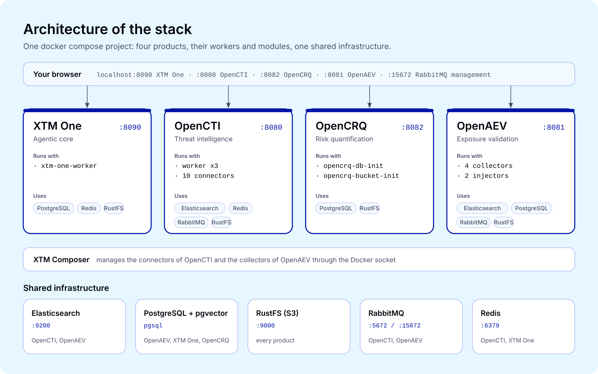
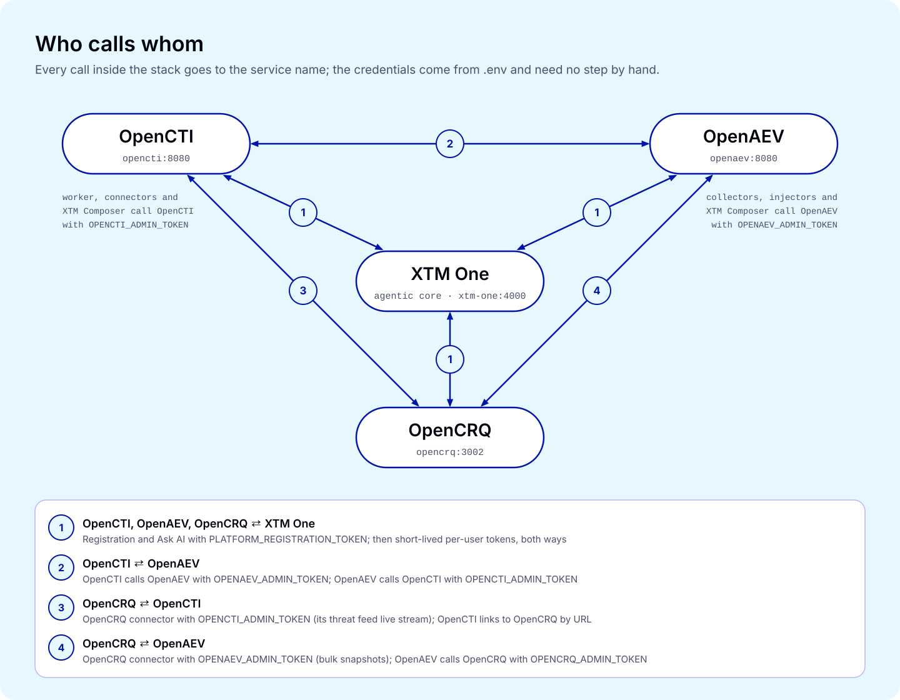

<a href="https://filigran.io"></a>

<p align="center">
  <a href="https://github.com/FiligranHQ/xtm-docker/actions/workflows/validate-compose.yml"></a>
  <a href="https://github.com/FiligranHQ/xtm-docker/commits/main"></a>
  <a href="https://docs.xtmone.io/latest/"></a>
  <a href="https://community.filigran.io"></a>
</p>

<p align="center"><b>The whole XTM Platform on one machine: XTM One, OpenCTI, OpenAEV and OpenCRQ, wired together by one Docker Compose file.</b></p>

This repository runs the four products of the [XTM Platform](https://filigran.io), the open platform for Agentic CTEM, with their workers, connectors, collectors and injectors and one shared infrastructure. Every integration between the products is configured from a single `.env` file: the products register with [XTM One](https://github.com/XTM-One-Platform/xtm-one), [OpenCTI](https://github.com/OpenCTI-Platform/opencti) and [OpenAEV](https://github.com/OpenAEV-Platform/openaev) exchange threats and coverage, and [OpenCRQ](https://github.com/OpenCRQ-Platform/opencrq) reads both to price the risk.

## Table of contents

- [Part of the XTM Platform](#part-of-the-xtm-platform)
- [Architecture](#architecture)
- [Integrations](#integrations)
- [Quick start](#quick-start)
- [Access](#access)
- [Configuration](#configuration)
- [Included modules](#included-modules)
- [Operations](#operations)
- [Upgrade](#upgrade)
- [Troubleshooting](#troubleshooting)
- [Community](#community)
- [About Filigran](#about-filigran)

## Part of the XTM Platform

The XTM Platform has five products. Each owns stages of the CTEM loop; XTM One runs the loop across them. This stack runs the first four; XTM Hub is the online library the products connect to.

<picture>
  <source media="(prefers-color-scheme: dark)" srcset="./.github/img/readme/xtm-platform-ctem-dark.svg">
  <source media="(prefers-color-scheme: light)" srcset="./.github/img/readme/xtm-platform-ctem-light.svg">
  
</picture>

| | Product | Role in CTEM | In this stack | Repository |
|---|---|---|---|---|
| <picture><source media="(prefers-color-scheme: dark)" srcset="./.github/img/readme/mark-xtm-one-dark.svg"></picture> | **XTM One** | Core and agentic layer: runs CTEM across the modules and gets the fix done | `xtm-one`, `xtm-one-worker` | [XTM-One-Platform/xtm-one](https://github.com/XTM-One-Platform/xtm-one) |
| <picture><source media="(prefers-color-scheme: dark)" srcset="./.github/img/readme/mark-opencti-dark.svg"></picture> | **OpenCTI** | Scoping and Discovery: know the adversary and the threats that target you | `opencti`, `worker`, 10 connectors | [OpenCTI-Platform/opencti](https://github.com/OpenCTI-Platform/opencti) |
| <picture><source media="(prefers-color-scheme: dark)" srcset="./.github/img/readme/mark-opencrq-dark.svg"></picture> | **OpenCRQ** | Prioritization: turn exposure into financial risk | `opencrq` | [OpenCRQ-Platform/opencrq](https://github.com/OpenCRQ-Platform/opencrq) |
| <picture><source media="(prefers-color-scheme: dark)" srcset="./.github/img/readme/mark-openaev-dark.svg"></picture> | **OpenAEV** | Validation: prove your defenses against real attacker techniques | `openaev`, 4 collectors, 2 injectors | [OpenAEV-Platform/openaev](https://github.com/OpenAEV-Platform/openaev) |
| <picture><source media="(prefers-color-scheme: dark)" srcset="./.github/img/readme/mark-xtm-hub-dark.svg"></picture> | **XTM Hub** | Tradecraft library and gateway: integrations, dashboards and scenarios for every product | online, not part of the stack | [XTM-Hub/xtm-hub](https://github.com/XTM-Hub/xtm-hub) |

## Architecture

One Compose project: the four products, their workers and modules, XTM Composer to manage the connectors and collectors, and one shared infrastructure. PostgreSQL holds one database each for OpenAEV, XTM One and OpenCRQ; Silo (S3) one bucket per product.

<picture>
  <source media="(prefers-color-scheme: dark)" srcset="./.github/img/readme/architecture-dark.svg">
  <source media="(prefers-color-scheme: light)" srcset="./.github/img/readme/architecture-light.svg">
  
</picture>

## Integrations

Inside the stack every call goes to the service name (`http://xtm-one:4000`, `http://opencti:8080`, `http://openaev:8080`, `http://opencrq:3002`), so the public host names never need to resolve inside Docker. The credentials come from `.env`; nothing is wired by hand.

<picture>
  <source media="(prefers-color-scheme: dark)" srcset="./.github/img/readme/integrations-dark.svg">
  <source media="(prefers-color-scheme: light)" srcset="./.github/img/readme/integrations-light.svg">
  
</picture>

| Caller | Callee | Credential | What for |
|---|---|---|---|
| OpenCTI, OpenAEV, OpenCRQ | XTM One | `PLATFORM_REGISTRATION_TOKEN` | Registration, the embedded AI assistant; then short-lived per-user tokens both ways |
| XTM One | OpenCTI, OpenAEV, OpenCRQ | per-user tokens it signs | Agents and platform MCP servers, on `OPENCTI_API_URL`, `OPENAEV_API_URL`, `OPENCRQ_API_URL` |
| OpenCTI | OpenAEV | `OPENAEV_ADMIN_TOKEN` | Scenarios from threats, links to OpenAEV (`XTM__OPENAEV_*`) |
| OpenAEV | OpenCTI | `OPENCTI_ADMIN_TOKEN` | Threat intelligence and security coverage written back (`OPENAEV_XTM_OPENCTI_*`) |
| OpenCRQ | OpenCTI | `OPENCTI_ADMIN_TOKEN` | OpenCRQ connector; OpenCRQ creates and binds its "OpenCRQ threat feed" live stream at start |
| OpenCRQ | OpenAEV | `OPENAEV_ADMIN_TOKEN` | OpenCRQ connector reading the bulk snapshots (`BULK_SNAPSHOT_EXPORT` preview feature, enabled on OpenAEV) |
| OpenAEV | OpenCRQ | `OPENCRQ_ADMIN_TOKEN` | Pivots and product switcher (`OPENAEV_XTM_OPENCRQ_*`) |
| OpenCTI | OpenCRQ | none | Product switcher link (`XTM__OPENCRQ_URL`) |
| OpenCTI worker and connectors, XTM Composer | OpenCTI | `OPENCTI_ADMIN_TOKEN` | Ingestion and connector management |
| OpenAEV collectors and injectors, XTM Composer | OpenAEV | `OPENAEV_ADMIN_TOKEN` | Collection, injection and collector management |

The public URLs (`*_EXTERNAL_SCHEME`, `*_HOST`, `*_PORT`) are the identity each product signs its requests with; [XTM Platform integration](https://docs.xtmone.io/latest/deployment/xtm-suite-integration/) explains the public and internal URLs in detail.

## Quick start

Requirements: Docker Engine 20.10+ with Docker Compose v2, 16 GB of RAM at least (32 GB for production), 50 GB of free disk.

```bash
git clone https://github.com/FiligranHQ/xtm-docker.git && cd xtm-docker
cp .env.sample .env      # replace every ChangeMe and changeme value, and every value marked [MANDATORY]
sudo sysctl -w vm.max_map_count=262144   # Elasticsearch, on Linux hosts
docker compose up -d
```

Generate the secrets with:

| Value | Command |
|---|---|
| Admin tokens (`OPENCTI_ADMIN_TOKEN`, `OPENAEV_ADMIN_TOKEN`, `OPENCRQ_ADMIN_TOKEN`) | `uuidgen` (UUID v4) |
| `OPENCTI_ENCRYPTION_KEY` | `openssl rand -base64 32` (not a UUID) |
| `PLATFORM_REGISTRATION_TOKEN`, `XTM_ONE_SECRET_KEY` | `openssl rand -hex 32` |
| Passwords | `openssl rand -hex 24` |

`PLATFORM_REGISTRATION_TOKEN` is the secret every product registers with XTM One: keep one value for the whole stack, and never the published default `xtm-default-registration-token`, with which XTM One registers no new platform and withholds the Filigran license from the products.

The first start takes several minutes: `docker compose ps` shows every service `healthy` (or `exited (0)` for the one-shot init services) when it is done.

## Access

| Service | URL | Sign in with |
|---|---|---|
| XTM One | http://localhost:8090 | `XTM_ONE_ADMIN_EMAIL` / `XTM_ONE_ADMIN_PASSWORD` |
| OpenCTI | http://localhost:8080 | `OPENCTI_ADMIN_EMAIL` / `OPENCTI_ADMIN_PASSWORD` |
| OpenAEV | http://localhost:8081 | `OPENAEV_ADMIN_EMAIL` / `OPENAEV_ADMIN_PASSWORD` |
| OpenCRQ | http://localhost:8082 | XTM One, as `XTM_ONE_ADMIN_EMAIL` (XTM One's administrator is OpenCRQ's super administrator) |
| RabbitMQ management | http://localhost:15672 | `RABBITMQ_DEFAULT_USER` / `RABBITMQ_DEFAULT_PASS` |
| Silo (S3) API | http://localhost:9000 | `MINIO_ROOT_USER` / `MINIO_ROOT_PASSWORD` |

The ports come from `XTM_ONE_PORT`, `OPENCTI_PORT`, `OPENCRQ_PORT` and `OPENAEV_PORT` in `.env`. The OpenAEV host port is also written in `docker-compose.yml` (`8081:8080`): change both together. Keep `XTM_ONE_ADMIN_EMAIL` equal to the admin email of the other products, so the users match between them.

## Configuration

Every setting lives in [`.env.sample`](.env.sample), one block per component:

| Block | Holds |
|---|---|
| `DEPENDENCIES` | Silo, RabbitMQ and PostgreSQL credentials, `ELASTIC_MEMORY_SIZE`, SMTP and IMAP |
| `COMMON` | `COMPOSE_PROJECT_NAME`, the XTM Composer id, `PLATFORM_REGISTRATION_TOKEN` |
| `OPENCTI` | Public URL, admin account and token, health key, encryption key |
| `OPENCTI CONNECTORS`, `OPENCTI DEFAULT DATA` | The connector ids |
| `OPENAEV` | Public URL, admin account and token, health key, encryption key and salt, IMAP switch |
| `OPENAEV COLLECTORS`, `OPENAEV INJECTORS` | The collector and injector ids, the optional NVD API key |
| `XTM ONE` | Public URL, admin account, secret key, PostgreSQL role, S3 bucket, enterprise license, logs |
| `OPENCRQ` | Public URL, admin token, PostgreSQL role, S3 bucket |

**Memory.** Set `ELASTIC_MEMORY_SIZE` to `2G` on a 16 GB host, `4G` on 32 GB, `8G` on 64 GB and more.

**Workers.** The OpenCTI `worker` service runs 3 replicas (`deploy.replicas` in `docker-compose.yml`); raise it for a higher ingestion throughput.

**External access.** Behind a reverse proxy, set the public URL of each product; the calls inside the stack keep the service names:

```bash
OPENCTI_EXTERNAL_SCHEME=https
OPENCTI_HOST=opencti.example.com
OPENCTI_PORT=443
# the same for OPENAEV_*, OPENCRQ_* and XTM_ONE_*
```

**OpenCRQ.** Two one-shot services prepare its storage on each start: `opencrq-db-init` creates its role and database in `pgsql`, `opencrq-bucket-init` its bucket in Silo. OpenCRQ registers with XTM One and creates its initial tenant at its first start. Its limits in this stack:

- Its session cookie is `Secure`: over plain HTTP, browsers accept it on `localhost` only, so a remote OpenCRQ must be published over TLS (`OPENCRQ_EXTERNAL_SCHEME=https`).
- The links it shows to OpenCTI and OpenAEV objects use the internal connector URLs (`http://opencti:8080`, `http://openaev:8080`).
- `OPENCRQ_POSTGRES_USER` is set once: changed after the first start, the `opencrq` database and its tables stay owned by the old role.
- It adds an HTTP and a worker process (heap capped at 512 MB and 4 GB) and about 50 PostgreSQL connections at peak to the `pgsql` instance.
- The automatic threat feed stream and the admin token as a bearer need OpenCRQ `0.261122.0` or later, the version `docker-compose.yml` pins. On an older OpenCRQ, link a service account to the connectors in **Integrations** by hand; OpenAEV cannot call it.

## Included modules

| Product | Module | What it does |
|---|---|---|
| OpenCTI | Export File STIX, CSV, TXT | Export data in STIX 2.1, CSV or plain text |
| OpenCTI | Import File STIX, Import File YARA | Import STIX 2.1 bundles and YARA rules |
| OpenCTI | Import Document, Analysis | Import and analyse PDF, HTML and text documents |
| OpenCTI | Import External Reference | Import external references |
| OpenCTI | OpenCTI Datasets, MITRE ATT&CK | Default marking definitions and identities, the ATT&CK framework |
| OpenAEV | MITRE ATT&CK, OpenAEV Datasets | Attack techniques, default datasets and configurations |
| OpenAEV | Atomic Red Team | Red Canary's Atomic Red Team tests |
| OpenAEV | NVD NIST CVE | CVE data from NVD (an API key is recommended) |
| OpenAEV | Nmap, Nuclei injectors | Network and vulnerability scanning |

## Operations

```bash
docker compose ps                    # state and health of every service
docker compose logs -f opencrq       # follow one service (opencti, openaev, xtm-one, ...)
docker compose down                  # stop the stack, data kept
docker compose down -v               # stop and DELETE every volume
```

## Upgrade

```bash
git pull
docker compose pull
docker compose up -d
```

Read the release notes of each product before an upgrade, and compare your `.env` with [`.env.sample`](.env.sample): a new block needs its values before the first start of the new version (a deployment that predates OpenCRQ needs `OPENCRQ_ADMIN_TOKEN` and `OPENCRQ_POSTGRES_PASSWORD`, or `opencrq-db-init` fails and OpenCRQ does not start).

### From separate PostgreSQL instances

Earlier versions of this stack ran two PostgreSQL containers: `pgsql` for OpenAEV and `pgsql-xtm-one` for XTM One. OpenAEV and XTM One now share one pgvector instance, on a new `pgsqlshareddata` volume, and the old volumes are left untouched. To keep your data, dump both databases **before** you pull the new version:

```bash
docker compose stop openaev xtm-one xtm-one-worker
docker compose exec -T pgsql sh -c 'pg_dump -U "$POSTGRES_USER" -Fc openaev' > openaev.dump
docker compose exec -T pgsql-xtm-one sh -c 'pg_dump -U "$POSTGRES_USER" -Fc xtm_one' > xtm_one.dump
docker compose down
```

Then pull the new version, prepare the shared instance (the `xtm-one-db-init` service creates the XTM One role, its database and the pgvector extension), restore both databases and start the stack:

```bash
git pull
docker compose run --rm xtm-one-db-init
docker compose exec -T pgsql sh -c 'pg_restore -U "$POSTGRES_USER" -d openaev' < openaev.dump
docker compose exec -T pgsql sh -c 'pg_restore -U "$POSTGRES_USER" -d xtm_one' < xtm_one.dump
docker compose up -d
```

Once both platforms show their data, remove the old volumes (their prefix is your `COMPOSE_PROJECT_NAME`):

```bash
docker volume rm xtm_pgsqldata xtm_pgsqlxtmonedata
```

If you started the new version before dumping, your data is still in the old volumes. The `xtm_pgsqlshareddata` volume then holds the databases the platforms created on that start, with everything written to them since, and removing it deletes those writes for good: if you need any of them, dump both databases from `pgsql` first, with the same `pg_dump` commands. Then run `docker compose down`, remove the `xtm_pgsqlshareddata` volume, check out the previous version of this repository, and follow the steps above.

## Troubleshooting

**A service does not start.** Read `docker compose ps` and `docker compose logs <service>`. Elasticsearch needs `vm.max_map_count=262144` on the host. A one-shot init service (`xtm-one-db-init`, `opencrq-db-init`, `opencrq-bucket-init`) that exits with an error keeps its product down: it usually names the missing `.env` value.

**Check each integration direction.** First that the caller reaches the callee on the internal network, then what the callee shows:

| Direction | Reachability | What to look at |
|---|---|---|
| OpenCTI → XTM One | `docker compose exec opencti wget -qO- http://xtm-one:4000/api/health` | XTM One, **Settings** → **MCP Endpoint**: OpenCTI reports `Connected`; the AI assistant appears in OpenCTI |
| OpenAEV → XTM One | `docker compose exec openaev wget -qO- http://xtm-one:4000/api/health` | Same, for OpenAEV |
| OpenCRQ → XTM One | `docker compose exec opencrq wget -qO- http://xtm-one:4000/api/health` | Same, for OpenCRQ; sign-in to OpenCRQ through XTM One works |
| XTM One → each product | `docker compose exec xtm-one curl -fsS http://opencti:8080/health?health_access_key=$OPENCTI_HEALTHCHECK_ACCESS_KEY` (OpenAEV: `http://openaev:8080/api/health?health_access_key=...`) | An agent answer on the product's data; a `401` means `XTM JWT rejected` in `docker compose logs xtm-one`, which names the issuer, audience or key URL that did not match |
| OpenCTI ⇄ OpenAEV | `docker compose exec opencti wget -qO- "http://openaev:8080/api/health?health_access_key=$OPENAEV_HEALTHCHECK_KEY"` | OpenAEV's coverage connector in the connector list of OpenCTI |
| OpenCRQ → OpenCTI | `docker compose exec opencrq wget -qO- "http://opencti:8080/health?health_access_key=$OPENCTI_HEALTHCHECK_ACCESS_KEY"` | The "OpenCRQ threat feed" live stream in OpenCTI's data sharing |
| OpenCRQ → OpenAEV | `docker compose exec opencrq wget -qO- "http://openaev:8080/api/health?health_access_key=$OPENAEV_HEALTHCHECK_KEY"` | The OpenAEV connector in OpenCRQ **Integrations** |
| OpenAEV → OpenCRQ | `docker compose exec openaev wget -S --spider http://opencrq:3002/` (any HTTP status answers: the port is reached) | The OpenCRQ pivots and product switcher in OpenAEV |

The `$...` values are read from your shell: export them from `.env` first, or paste them. When every direction is reachable and a product still shows as not connected, check that `PLATFORM_REGISTRATION_TOKEN` and the admin tokens are the same on both sides, that the clocks of the host are synchronised (the tokens between the products live 10 minutes), and see the [XTM One troubleshooting](https://docs.xtmone.io/latest/deployment/troubleshooting/) page.

**OpenAEV fails to register its coverage connector in OpenCTI.** OpenAEV sends a GraphQL introspection query that OpenCTI refuses by default since `7.261109.0`. The compose file allows it on OpenCTI (`APP__GRAPHQL__PLAYGROUND__FORCE_DISABLED_INTROSPECTION=false`) until a released OpenAEV no longer needs it ([OpenAEV-Platform/openaev#9647](https://github.com/OpenAEV-Platform/openaev/issues/9647)).

## Community

- **Questions and discussion**: the Filigran [community Slack](https://community.filigran.io).
- **Bugs in this stack**: [issues of this repository](https://github.com/FiligranHQ/xtm-docker/issues).
- **Bugs in a product**: [XTM One](https://github.com/XTM-One-Platform/xtm-one/issues), [OpenCTI](https://github.com/OpenCTI-Platform/opencti/issues), [OpenAEV](https://github.com/OpenAEV-Platform/openaev/issues), [OpenCRQ](https://github.com/OpenCRQ-Platform/opencrq/issues).
- **Contributing**: read the [contributing guide](CONTRIBUTING.md).

## About Filigran

The XTM Platform is designed and developed by [Filigran](https://filigran.io), the company behind the XTM Platform for Agentic CTEM.

<picture>
  <source media="(prefers-color-scheme: dark)" srcset="./.github/img/readme/filigran-dark.svg">
  <source media="(prefers-color-scheme: light)" srcset="./.github/img/readme/filigran-light.svg">
  
</picture>
