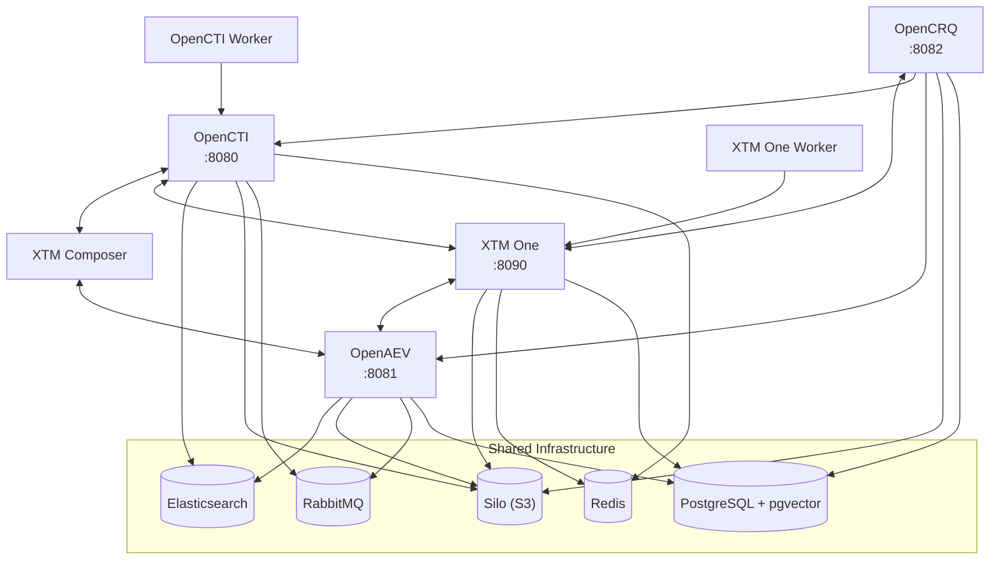

# XTM Docker Deployment

Docker deployment for the **eXtended Threat Management (XTM)** stack, combining [OpenCTI](https://github.com/OpenCTI-Platform/opencti), [OpenAEV](https://github.com/OpenAEV-Platform/openaev), OpenCRQ and [XTM One](https://github.com/XTM-One-Platform/xtm-one) into a unified threat intelligence, adversary emulation, cyber risk quantification and AI-assisted analysis platform.

## Overview

This repository provides a complete Docker Compose setup for running:

- **OpenCTI** — Open Cyber Threat Intelligence Platform
- **OpenAEV** — Open Adversary Emulation & Validation Platform
- **OpenCRQ** — Cyber Risk Quantification Platform, fed by OpenCTI and OpenAEV
- **XTM One** — AI-powered assistant connecting OpenCTI, OpenAEV and OpenCRQ
- **XTM Composer** — Unified connector/collector management
- **Shared Infrastructure** — Elasticsearch, Silo (S3 object storage), RabbitMQ, Redis, PostgreSQL + pgvector (one database each for OpenAEV, XTM One and OpenCRQ)

## Prerequisites

- Docker Engine 20.10+
- Docker Compose v2.0+
- Minimum 16GB RAM (recommended 32GB for production)
- At least 50GB available disk space

## Architecture



## Quick Start

### 1. Clone the repository

```bash
git clone https://github.com/FiligranHQ/xtm-docker.git
cd xtm-docker
```

### 2. Create environment file

Create a `.env` file with the required configuration. An example is available in [.env.sample](.env.sample).

```bash
# PostgreSQL (superuser of the shared instance, used by OpenAEV)
POSTGRES_USER=openaev
POSTGRES_PASSWORD=<generate-strong-password>

# Silo (S3 object storage, the variables keep their MINIO_ prefix)
MINIO_ROOT_USER=minioadmin
MINIO_ROOT_PASSWORD=<generate-strong-password>

# RabbitMQ
RABBITMQ_DEFAULT_USER=guest
RABBITMQ_DEFAULT_PASS=<generate-strong-password>

# OpenCTI
OPENCTI_EXTERNAL_SCHEME=http
OPENCTI_HOST=localhost
OPENCTI_PORT=8080
OPENCTI_ADMIN_EMAIL=admin@filigran.io
OPENCTI_ADMIN_PASSWORD=<generate-strong-password>
OPENCTI_ADMIN_TOKEN=<generate-uuid-v4>
OPENCTI_HEALTHCHECK_ACCESS_KEY=<generate-uuid-v4>

# OpenAEV
OPENAEV_EXTERNAL_SCHEME=http
OPENAEV_HOST=localhost
OPENAEV_PORT=8081
OPENAEV_ADMIN_EMAIL=admin@filigran.io
OPENAEV_ADMIN_PASSWORD=<generate-strong-password>
OPENAEV_ADMIN_TOKEN=<generate-uuid-v4>
OPENAEV_HEALTHCHECK_KEY=<generate-uuid-v4>

# OpenCRQ
OPENCRQ_EXTERNAL_SCHEME=http
OPENCRQ_HOST=localhost
OPENCRQ_PORT=8082
OPENCRQ_ADMIN_TOKEN=<generate-uuid-v4>
OPENCRQ_POSTGRES_USER=opencrq
OPENCRQ_POSTGRES_PASSWORD=<generate-strong-password>

# SMTP (mandatory)
SMTP_HOST=localhost
SMTP_PORT=25
SMTP_USERNAME=
SMTP_PASSWORD=
SMTP_AUTH=false
SMTP_SSL_ENABLE=false
SMTP_STARTTLS_ENABLE=false

# IMAP (optional)
OPENAEV_MAIL_IMAP_ENABLED=false
IMAP_HOST=
IMAP_PORT=993
IMAP_USERNAME=
IMAP_PASSWORD=
IMAP_AUTH=true
IMAP_SSL_ENABLE=true
IMAP_STARTTLS_ENABLE=false
```

> **Tip:** Generate UUIDs using `uuidgen`. `OPENCTI_ENCRYPTION_KEY` must be a 32-byte base64 string produced with `openssl rand -base64 32`, **not** a UUID. `XTM_ONE_SECRET_KEY` and `PLATFORM_REGISTRATION_TOKEN` can be any long random string (e.g. `openssl rand -hex 32`).
>
> The full XTM One configuration (admin credentials, image tag, the credentials of its PostgreSQL role, S3 bucket, license) lives at the bottom of [.env.sample](.env.sample). `PLATFORM_REGISTRATION_TOKEN` is the shared secret that lets OpenCTI, OpenAEV and OpenCRQ register themselves with XTM One — it MUST be identical for the four platforms.

### 3. Start the stack

```bash
docker compose up -d
```

### 4. Access the platforms

Once all services are healthy (this may take a few minutes on first start):

- **OpenCTI**: http://localhost:8080
- **OpenAEV**: http://localhost:8081
- **OpenCRQ**: http://localhost:8082
- **XTM One**: http://localhost:8090
- **RabbitMQ Management**: http://localhost:15672

> **Public and internal URLs:** the URLs above (built from `OPENCTI_HOST`, `OPENAEV_HOST`, `XTM_ONE_HOST`, their ports and their `*_EXTERNAL_SCHEME`: set the scheme to `https` together with the host when you publish them over TLS) are also the identity each product signs its requests to the others with, so they are set on both XTM One containers (`BASE_URL`). Inside the stack the containers reach each other on their service names (`http://opencti:8080`, `http://openaev:8080`, `http://opencrq:3002`, `http://xtm-one:4000`), so the public host names do not need to resolve inside Docker. This needs XTM One, OpenCTI and OpenAEV releases that include [XTM-One-Platform/xtm-one#4883](https://github.com/XTM-One-Platform/xtm-one/pull/4883), [OpenCTI-Platform/opencti#18585](https://github.com/OpenCTI-Platform/opencti/pull/18585) and [OpenAEV-Platform/openaev#8143](https://github.com/OpenAEV-Platform/openaev/pull/8143).

## Included Components

### OpenCTI Connectors

| Connector | Description |
|-----------|-------------|
| Export File STIX | Export data in STIX 2.1 format |
| Export File CSV | Export data in CSV format |
| Export File TXT | Export data in plain text format |
| Import File STIX | Import STIX 2.1 bundles |
| Import Document | Import and analyze PDF, HTML, and text documents |
| Import File YARA | Import YARA rules |
| Analysis | Document analysis connector |
| Import External Reference | Import external references |
| OpenCTI Datasets | Default marking definitions and identities |
| MITRE ATT&CK | MITRE ATT&CK framework data |

### OpenAEV Collectors

| Collector | Description |
|-----------|-------------|
| MITRE ATT&CK | Attack techniques and procedures |
| OpenAEV Datasets | Default datasets and configurations |
| Atomic Red Team | Red Canary's Atomic Red Team tests |
| NVD NIST CVE | CVE data from NVD (requires API key) |

### OpenAEV Injectors

| Injector | Description |
|-----------|-------------|
| Nmap | Network scanning capabilities |
| Nuclei | Vulnerability scanning with Nuclei |

## Configuration

### Memory Requirements

Adjust `ELASTIC_MEMORY_SIZE` based on your available RAM:

| Total RAM | Recommended Setting |
|-----------|---------------------|
| 16GB | `2G` |
| 32GB | `4G` |
| 64GB+ | `8G` |

### Scaling Workers

Modify the worker replicas in `docker-compose.yml`:

```yaml
worker:
  deploy:
    mode: replicated
    replicas: 3  # Increase for higher throughput
```

### External Access

To expose the platforms externally (behind reverse-proxy for instance), update the environment variables:

```bash
OPENCTI_EXTERNAL_SCHEME=https
OPENCTI_HOST=opencti.yourdomain.com
OPENCTI_PORT=443

OPENAEV_EXTERNAL_SCHEME=https
OPENAEV_HOST=openaev.yourdomain.com
OPENAEV_PORT=443

OPENCRQ_EXTERNAL_SCHEME=https
OPENCRQ_HOST=opencrq.yourdomain.com
OPENCRQ_PORT=443
```

### OpenCRQ

Two one-shot services prepare the storage of OpenCRQ on each start: `opencrq-db-init` creates its role and database in the shared `pgsql` instance, and `opencrq-bucket-init` creates its bucket in Silo. A deployment that predates OpenCRQ needs `OPENCRQ_POSTGRES_PASSWORD` in its `.env` before it pulls this version: without it, `opencrq-db-init` fails and OpenCRQ does not start.

OpenCRQ registers with XTM One with the same `PLATFORM_REGISTRATION_TOKEN`. At its first start it creates its initial tenant, and every integration is wired with the admin token of each product, with nothing to do by hand:

| Direction | How |
|---|---|
| OpenCRQ → XTM One | Registration and sign-in with `PLATFORM_REGISTRATION_TOKEN` |
| OpenCRQ → OpenCTI | Connector with `OPENCTI_ADMIN_TOKEN`; OpenCRQ creates and binds its "OpenCRQ threat feed" live stream at start |
| OpenCRQ → OpenAEV | Connector with `OPENAEV_ADMIN_TOKEN`, reading the bulk snapshots (`BULK_SNAPSHOT_EXPORT` preview feature, enabled on OpenAEV) |
| OpenAEV → OpenCRQ | Pivots and product switcher with `OPENCRQ_ADMIN_TOKEN`, an admin bearer on the OpenCRQ API |
| OpenCTI → OpenCRQ | Product switcher (`XTM__OPENCRQ_URL`) |
| XTM One → OpenCRQ | `OPENCRQ_API_URL`, with the tokens OpenCRQ registers |

Open http://localhost:8082 and sign in with XTM One as `XTM_ONE_ADMIN_EMAIL`: XTM One's administrator is OpenCRQ's super administrator, and lands in the initial tenant.

The automatic threat feed stream and the admin token as a bearer come with OpenCRQ `0.261122.0` and later (OpenCRQ-Platform/opencrq#57 and #63), the version this compose file pins. On an older OpenCRQ, link a service account to the connectors in **Integrations** by hand, and OpenAEV cannot call OpenCRQ.

Limitations:

- The OpenCRQ session cookie is `Secure`. Over plain HTTP, browsers accept it on `localhost` at most, so a remote OpenCRQ must be published over TLS (`OPENCRQ_EXTERNAL_SCHEME=https`).
- The links OpenCRQ shows to OpenCTI and OpenAEV objects use the connector URLs, which are the internal `http://opencti:8080` and `http://openaev:8080`.
- OpenCRQ takes its edition from the Filigran license XTM One returns at registration, which XTM One withholds while `PLATFORM_REGISTRATION_TOKEN` keeps its published default.
- `OPENCRQ_POSTGRES_USER` is set once: changed after the first start, `opencrq-db-init` creates the new role, but the `opencrq` database and its tables stay owned by the old one.
- OpenCRQ adds an HTTP and a worker process (heap capped at 512 MB and 4 GB) and about 50 PostgreSQL connections at peak to the `pgsql` instance it shares with OpenAEV and XTM One.

## Common Operations

### View logs

```bash
# All services
docker compose logs -f

# Specific service
docker compose logs -f opencti
docker compose logs -f openaev
docker compose logs -f opencrq
```

### Check service health

```bash
docker compose ps
```

### Stop the stack

```bash
docker compose down
```

### Reset data (destructive)

```bash
docker compose down -v
```

### Upgrade from separate PostgreSQL instances

Earlier versions of this stack ran two PostgreSQL containers: `pgsql` for OpenAEV and `pgsql-xtm-one` for XTM One. OpenAEV and XTM One now share one pgvector instance, on a new `pgsqlshareddata` volume, and the old volumes are left untouched. To keep your data, dump both databases **before** you pull the new version:

```bash
docker compose stop openaev xtm-one xtm-one-worker
docker compose exec -T pgsql sh -c 'pg_dump -U "$POSTGRES_USER" -Fc openaev' > openaev.dump
docker compose exec -T pgsql-xtm-one sh -c 'pg_dump -U "$POSTGRES_USER" -Fc xtm_one' > xtm_one.dump
docker compose down
```

Then pull the new version, prepare the shared instance (the `xtm-one-db-init` service creates the XTM One role, its database and the pgvector extension), restore both databases and start the stack:

```bash
git pull
docker compose run --rm xtm-one-db-init
docker compose exec -T pgsql sh -c 'pg_restore -U "$POSTGRES_USER" -d openaev' < openaev.dump
docker compose exec -T pgsql sh -c 'pg_restore -U "$POSTGRES_USER" -d xtm_one' < xtm_one.dump
docker compose up -d
```

Once both platforms show their data, remove the old volumes (their prefix is your `COMPOSE_PROJECT_NAME`):

```bash
docker volume rm xtm_pgsqldata xtm_pgsqlxtmonedata
```

If you started the new version before dumping, your data is still in the old volumes. The `xtm_pgsqlshareddata` volume then holds the databases the platforms created on that start, with everything written to them since, and removing it deletes those writes for good: if you need any of them, dump both databases from `pgsql` first, with the same `pg_dump` commands. Then run `docker compose down`, remove the `xtm_pgsqlshareddata` volume, check out the previous version of this repository, and follow the steps above.

## Troubleshooting

### Services not starting

1. Check if Elasticsearch has enough virtual memory:
   ```bash
   sudo sysctl -w vm.max_map_count=262144
   ```

2. Verify all environment variables are set in `.env`

3. Check logs for specific errors:
   ```bash
   docker compose logs <service-name>
   ```

### OpenCTI/OpenAEV/OpenCRQ not connecting

1. Ensure all dependency services are healthy
2. Verify tokens match between services
3. Check network connectivity within Docker network

## Community

### Status & Bugs

If you wish to report bugs or request new features:

- **OpenCTI**: [GitHub Issues](https://github.com/OpenCTI-Platform/opencti/issues)
- **OpenAEV**: [GitHub Issues](https://github.com/OpenAEV-Platform/openaev/issues)

### Discussion

For support or discussions about the XTM stack, join us on our [Slack channel](https://community.filigran.io) or email us at contact@filigran.io.

## About

XTM is a product suite designed and developed by [Filigran](https://filigran.io).

<a href="https://filigran.io" alt="Filigran"></a>
